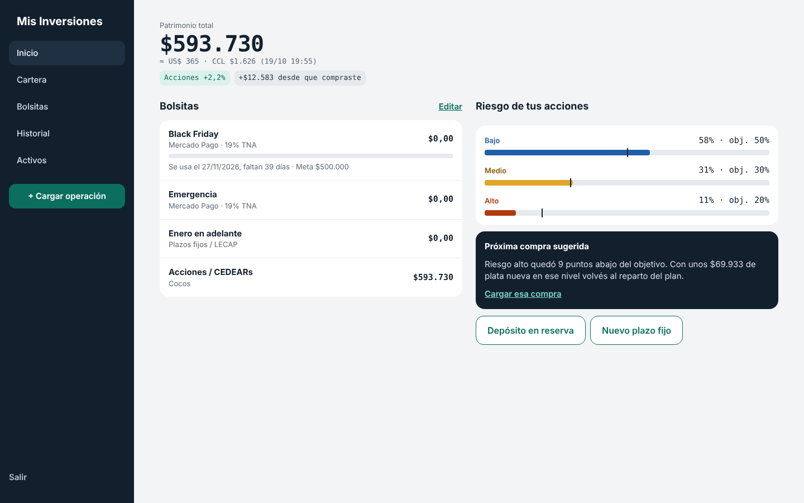
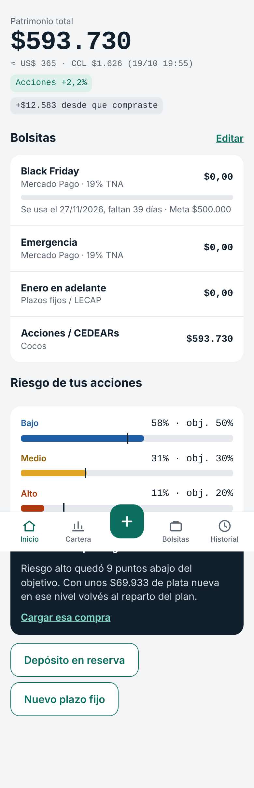

# Mis Inversiones

[](https://github.com/vLaauTy/mis-inversiones/actions/workflows/ci.yml)

App web personal para seguir inversiones: cartera de acciones y CEDEARs, bolsitas (reservas, emergencia,
plazos fijos), reparto por nivel de riesgo y próxima compra sugerida. Hecha con Spring Boot + Thymeleaf,
funciona en PC y celular.

| PC | Celular |
| --- | --- |
|  |  |

**Stack:** Java 21 · Spring Boot 4.1 · Spring MVC + Thymeleaf · Spring Data JPA · Spring Security ·
Flyway · H2 (desarrollo) / PostgreSQL (producción) · JUnit 5 + MockMvc · Docker · GitHub Actions.

## Estado: etapa 2 de 6 (precios automáticos)

| Etapa | Qué trae | Estado |
| --- | --- | --- |
| 1. Base usable | Login, activos, compras y ventas, bolsitas, plazos fijos, Inicio, Cartera con precio manual, historial | ✅ |
| 2. Precios automáticos | BYMA Open Data + data912, cada 15 min, cierre diario, CCL | ✅ |
| 3. Análisis | Rendimiento vs inflación/CCL/plazo fijo, Plan, Simulador | Pendiente |
| 4. Avisos | Bot de Telegram, vencimientos, resumen semanal | Pendiente |
| 5. IA para cargar | Frase y captura del comprobante (Haiku 5.5) | Pendiente |
| 6. Radar de riesgo | Semáforo diario + noticias si se movió más de 3% | Pendiente |

## Cómo correrla en tu PC (desarrollo)

Requisitos: Java 21.

```powershell
# 1. Contraseña para entrar (una sola vez; después cerrá y abrí la terminal)
setx APP_PASSWORD "una-contraseña-larga"

# 2. Levantar la app
.\mvnw.cmd spring-boot:run
```

Abrí <http://localhost:8080> y entrá con usuario `lauti` y la contraseña que definiste.
Sin `APP_PASSWORD`, la contraseña es `cambiame` (solo en desarrollo; en prod la app no arranca así).

- Los datos se guardan en `data/` (base H2 en archivo, no se sube a git).
- Consola de la base: <http://localhost:8080/h2> (JDBC URL `jdbc:h2:file:./data/mis-inversiones`, usuario `sa`).
- Desde el celular, en el mismo Wi-Fi: `http://<IP de tu PC>:8080` (Windows puede pedir permiso en el firewall).

## Precios automáticos

De lunes a viernes, de 11 a 17:45, cada 15 minutos (y una vez al arrancar) la app pide los paneles de
acciones y CEDEARs y guarda el precio de cada activo que tenés cargado. También guarda el dólar CCL, que
se usa para mostrar el patrimonio en dólares. En Cartera hay un botón **Actualizar ahora** para no esperar.

| Fuente | Para qué | Notas |
| --- | --- | --- |
| [BYMA Open Data](https://open.bymadata.com.ar) | Precio principal (plazo 24 hs, en pesos) | Gratis, ~20 min de demora, API no documentada |
| [data912](https://data912.com) | Respaldo si BYMA falla o no tiene el ticker | GET simple, sin clave |
| [dolarapi.com](https://dolarapi.com) | Dólar contado con liquidación | Se usa el valor de venta |

Si una fuente no responde se pasa a la siguiente; si ninguna tiene un ticker, la app avisa cuál quedó sin
precio y se sigue usando el último. El orden y el horario se cambian en `app.precios` (`application.yml`);
con `app.precios.automaticos=false` no se programa nada y se puede seguir cargando a mano.

## Tests

```powershell
.\mvnw.cmd verify
```

## Producción (más adelante)

`docker compose up -d --build` levanta la app con PostgreSQL usando las variables de `.env`
(copiá `.env.example`). Para entrar desde el celular fuera de casa hace falta un túnel seguro
(tipo Cloudflare Tunnel).

## Estructura

```
com.vlaauty.misinversiones
├── config        seguridad, reloj, tareas programadas y propiedades validadas al arrancar
├── dominio       entidades JPA, enums y cálculo de interés
├── integracion   clientes HTTP de BYMA, data912 y dolarapi (RestClient)
├── repositorio   interfaces Spring Data
├── servicio      reglas de negocio y cálculos puros (costo promedio, reparto, comisiones)
└── web           controladores, formularios (form → comando) y formato argentino
src/main/resources
├── templates     vistas Thymeleaf (layout común en fragmentos/)
├── static        CSS responsive, ícono y manifest (instalable en el celu)
└── db/migration  esquema y datos iniciales con Flyway
```

Capas: los controladores solo traducen HTTP ↔ formularios; los servicios aplican las reglas
(no vender más de lo que tenés, no retirar más del saldo, etc.) y lanzan `ReglaNegocioException`
con un mensaje para el usuario; los cálculos que no tocan la base (`CalculadoraPosiciones`,
`CalculadoraReparto`, `CalculadoraComision`) son clases puras, testeadas sin Spring.

## Decisiones

- Comisión estimada: Cocos, 0,45% + IVA (`app.comision` en `application.yml`). Si cargás la comisión real del
  comprobante, se usa esa.
- Costo de las acciones: costo promedio ponderado, con comisiones de compra incluidas.
- Tasas: se cargan en porcentaje (22) y se guardan como fracción (0,22).
- La cartera nunca guarda saldos: se recalcula siempre desde las operaciones.
- Precios: cada fuente implementa `ProveedorCotizaciones`; `ActualizadorPrecios` las recorre en orden y no
  abre transacción mientras espera la red. Fuera de horario no se repite el mismo cierre.
- Los tests nunca salen a internet: los clientes se prueban con `MockRestServiceServer` y respuestas reales recortadas.
